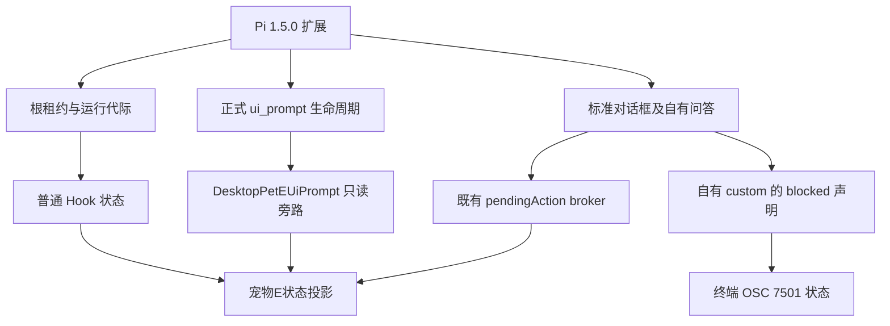
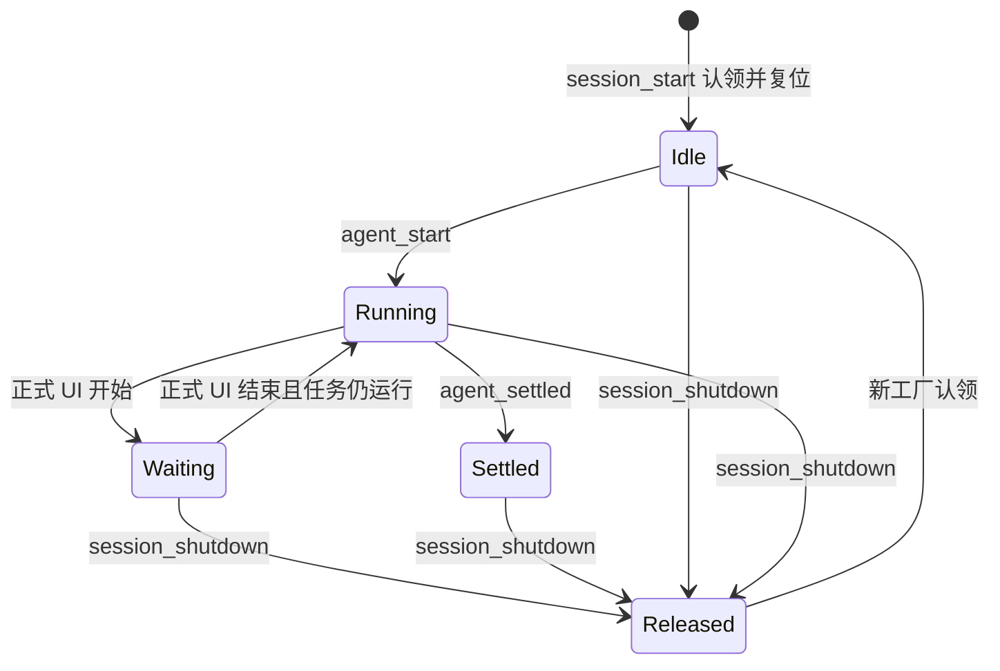

# 技术设计：V1.5.0 集成与 Pi 1.5.0 兼容

## 分诊与根因边界

这是跨层上游集成及外部 API 适配，按根因路径处理。
已确认的兼容缺口在生产者与共享契约边界：自有 custom 问答没有声明 Pi 1.5.0 新增的终端阻塞状态；上游删除远程托管字段并重排 Windows helper 打包流程，fork 的旧消费者与早退分支必须一起接齐。
没有证据表明 Pi 1.5.0 废弃了正式 UI 事件或普通生命周期，不能为了适配而改写已有状态协议。

## 证据与技术决策

| 决策 | 证据与处理 |
|---|---|
| KTD1：固定合并目标 | `V1.5.0^{}` 与 `upstream/master` 同为 `50e0f17f`；从 `2388905d` 分出新集成分支，不从旧本地 master 开始 |
| KTD2：合并后检查交叉消费 | 30 个共同修改路径只是冲突候选；无文本冲突的 fork 文件也可能引用已删除类型，必须审阅新增 helper、设置图标映射和宠物E消费端 |
| KTD3：保留外部模板 | `src-tauri/src/pi_extension_template.ts` 仍是唯一托管实现，保留 include_str!、v11 生命周期及 2 秒超时；模板改动升至 12 |
| KTD4：blocked 与正式事件并行 | Pi 1.5.0 `ExtensionUIContext.custom` 支持 blocked 对象；interactive-mode 将其用于 OSC 7501。runner 仍对每次 custom 无条件调用 withUIPrompt，与 blocked 不互相代替 |
| KTD5：schema 不做无证据迁移 | 官方改用 pi-schema 校验标准 JSON Schema；现有 Object/Array/String/Boolean/Optional 均符合。loader 仍为 typebox 提供 alias/virtualModules，不需安装新依赖或更换为私有入口 |
| KTD6：按能力兼容 | 保留标准 select/confirm/input 的安全竞速、正式只读等待和普通通知三通道；不解析第三方自绘选项，不改 Pi/rpiv |
| KTD7：单代理本地实施 | 当前无外部实现引擎配置、无可调用的子代理或 GitNexus；按契约、Git 差异及符号引用审查，不启动技能中的安装/执行脚本 |

## 数据流与生命周期

自有问答使用 inline custom 并提供 question 类型的 blocked 描述；仍由 done/AbortSignal 收尾，不能通过终端状态直接提交答案。
是否存在额外 TUI 接口不匹配在实施时逐项对照声明；没有证据的重构不纳入。

## 发现清单

| 触点 | 本轮处理 |
|---|---|
| `src-tauri/src/pi_extension_template.ts`、`features/hooks/settings/{pi,mod}.rs` | custom 选项、标准 schema、模板装载与升版 |
| `scripts/piHookSdk.test.mjs`、`piHookLifecycle.test.mjs`、`piDesktopPetHook.test.mjs` | 官方 1.5.0 SDK 夹具与现有生命周期契约核对 |
| 新增独立 Pi 1.5.0 兼容夹具 | 自有 custom blocked、完成/取消及事件独立性；不复制整份生产实现 |
| `features/hooks/claude.rs`、`desktop_pet_e_ui_prompt.rs`、`desktop_pet_e_completion.rs`、`pi_admission.rs` | 确认鉴权、白名单、接纳门与两种旁路不被合并覆盖 |
| `infrastructure/daemon/server.rs`、`server/hook_status.rs`、`server/pi_session_lifecycle.rs` | 接纳上游队列/恢复改动，保留私有事件提前返回与 Pi 空闲复位 |
| `features/hooks/client.rs`、`src-tauri/src/lib.rs`、`commands/mod.rs` | 上游删除远程托管后保留仍有 fork 调用者的接口；注册不能遗漏 |
| `src/app/App.tsx`、终端 store/transport/types | 保留宠物E接线及 Pi 守卫，接纳上游恢复和退出治理 |
| `src/shared/lib/desktopPetEState.ts`、`scripts/desktopPetEState.test.mjs` | 移除对已删除 remoteHandoff 契约的直接依赖，检查旧会话迁移边界 |
| 原宠物与 `BackgroundTasksPanel` | 保留明确 none 消费，兼容共享 daemon inventory |
| `SettingsModal.tsx`、`SettingsIcons.tsx`、settingsStore、syncSettings | 保留宠物E设置入口、图标可用性、互斥和顶层折叠偏好；新增 `preferences/desktopPetEPreferences.ts` 承载偏好迁移、加载互斥及写入校验，原 store 显式重导出 |
| `useTerminalTabsController.tsx`、`terminal/lib/desktopPetETabNotifications.ts` | 在终端域提取重复的真实待答关注覆盖，不修改普通 Hook 状态；与偏好提取共同解决合并后的 2000 行超限 |
| `scripts/prepare-bundle-binaries.mjs`、`prepare-helper-binaries.mjs`、`src-tauri/helpers/` | helper 构建不得被宠物E Windows 分支早退跳过；复用包含 fork 模块的主库 |
| `scripts/package-portable.ps1`、Tauri 配置、release/alpha workflow | Electron 与 Tap 资源、helper 路径、稳定安装包版本和发布入口 |
| `CHANGELOG.md`、`docs/功能清单.md`、外挂契约 | 在 V1.5.0 段首记录同步与兼容；旧 fork 记录保留 |
| Pi/rpiv 安装目录、主 worktree、旧未跟踪任务 | 仅必要读取 Pi 官方发行文件；其余不修改 |

## 风险与保留项

- 上游大量旧任务删除是正式历史的一部分；不能用全库 ours/theirs 解决，也不能顺带清理 fork 独有记录。
- 服务端问答 `/open` 仍按 Tab 替换待答，跨会话请求处理乱序是既有已知风险；本轮不改 broker 协议。
- 未执行 TS/Rust 编译或行为验收，依赖/构建兼容不能只凭文本合并宣称通过。
- 官方 SDK 回归保持可选；显式指定无效 SDK 路径或错误版本应报错，不能伪装为通过。未提供 SDK 时可以明确跳过。
- 用户本轮已确认提交并推送，最终目标为 `origin/master`；仅允许普通快进，不创建 main 或更改默认分支。

## 资料定位

外部依据来自本机 `@earendil-works/pi-coding-agent` 1.5.0 发行包：`CHANGELOG.md`、`docs/extensions.md`、`docs/tui.md`、`dist/core/extensions/{types.d.ts,loader.js,runner.js}`、`dist/modes/interactive/interactive-mode.js`。
`@earendil-works/pi-tui/dist/index.d.ts` 与 `components/editor.d.ts` 已核对现有静态导出；Pi 本身没有被启动或改写。
