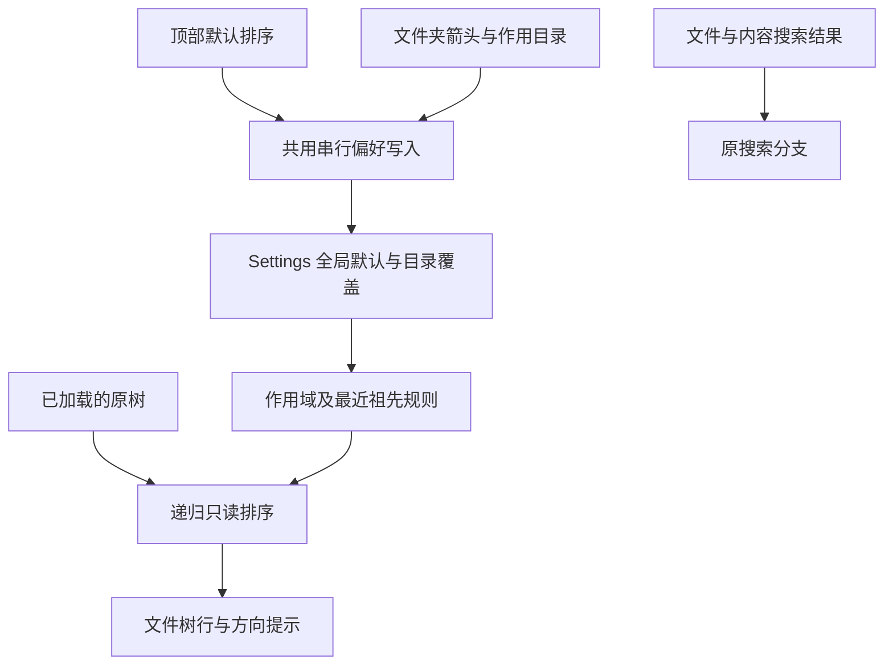

# 技术设计：文件夹独立排序

## 现有依据与分诊

这是显示偏好的跨层增强，不是文件系统排序或后端性能修复。
当前 `src/shared/lib/fileTreeSort.ts` 提供目录优先、递归不可变排序和单项更新器；`src/shared/preferences/fileTreeSortPreference.ts` 共用串行保存队列。
`FileExplorerSidebar.tsx` 的 `FileNode`/`FileTreeRows` 渲染树与紧凑目录链，搜索走独立分支；`FileTreeSortMenu.tsx` 已有保存、错误、单选及键盘导航。

已定位的重要边界：

- `projectWithWorktreePath` 保留项目 ID 但替换根路径，因此不能只按 `project.id` 索引新偏好。
- `fileContentRoot` 与 `fileOperationRootKey` 已区分 SSH 主机/远程根，以及 Windows 不区分大小写、WSL/POSIX 保留大小写。
- `FileNode` 整行接收指针、点击及键盘事件；Portal 事件仍可能沿 React 祖先传播，需要隔离排序控件。
- 紧凑目录链已有 `chainPaths` 和 `displayEntry`，无需取消紧凑显示或重新读取目录。
- `settingsStore.ts` 当前 1982 行，`FileExplorerSidebar.tsx` 1830 行；业务规则不扩入这两个共有文件。
- GitNexus runner 与子代理工具当前不可用，以现有契约及源码交叉引用调研；未运行应用、构建或测试。

## 技术决策

- KTD1. **保留全局默认，增加目录覆盖表。** 新 `Settings.fileTreeSortOverrides` 默认空表，按作用域键映射相对目录到完整的 `FileTreeSortSettings`。保留原 `Settings.fileTreeSort` 类型及默认值；旧用户无需迁移全局选择，新字段缺失即无覆盖。
- KTD2. **项目与文件根共同隔离。** 新 feature helper 复用 `fileContentRoot(project)`，将项目 ID、环境类型和文件根组成无歧义的 JSON 元组作用域键。相对路径按环境规范化；本地 Windows/普通 UNC 忽略大小写，WSL/POSIX/SSH 保留大小写。共享层只接收已构造的作用域，不反向导入 feature。
- KTD3. **递归时传递有效规则。** 扩展 `sortFileTreeEntries` 的可选目录规则解析入口，保留原双参数行为。父级规则排序本层条目，进入目录 children 时才应用该目录覆盖；没有覆盖则传下当前规则。显示规则查询按路径段寻找最近祖先，不能用裸字符串前缀把 `src2` 当作 `src` 后代。落实 R3–R5。
- KTD4. **全局与目录操作共用串行队列。** 现有偏好模块扩展为一个写队列，捕获操作目标、单项变更或 reset 意图；出队时读取最新全局与覆盖表，计算完整显式规则后只更新相关 Settings 键。不能从菜单旧快照回写整表；失败传播给当前菜单，恢复后续队列。
- KTD5. **同值选择可以固定，reset 只撤当前覆盖。** 不能因有效值未变跳过首次显式设置；已有相同覆盖才可省略写入。恢复继承删除目标项并清理空作用域，不递归删除后代覆盖。
- KTD6. **复用菜单，独立目录包装。** `FolderTreeSortMenu.tsx` 管理目录目标、继承提示和 reset，复用 `FileTreeSortMenu.tsx` 的规则选项/保存反馈。树控件读同一份偏好；无需为每个目录建立轮询、持久化 store 或后端请求。
- KTD7. **控件与行激活区域分离。** 箭头为独立可聚焦按钮，与目录展开/选择区域分开，避免在原行按钮语义中嵌套另一个按钮；同一行固定预留位置，不挤掉 Git 标记。控件及其菜单阻止事件冒泡到文件行/根快捷键，但保留按钮焦点、菜单 Tab/Esc 和默认键盘激活。
- KTD8. **紧凑链可选择作用目录。** 每行保留一个箭头，默认以可见末级为目标；菜单在链长大于 1 时提供链中各级路径选择。标题和提示明确目标及继承来源；中间层有覆盖时也能看见并恢复。项目/根或链身份改变时关闭旧菜单，旧保存只作用于已捕获目标。
- KTD9. **仅投影已加载树。** 排序不触发 `loadDir`、Git 刷新或文件写入；之后新加载的后代按当时有效规则显示。文件名搜索、内容搜索、展开集合、选中路径、脏编辑内容不改变。
- KTD10. **偏好加载和写入均校验。** 覆盖迁移纯函数在缺失、数组或畸形记录时返回空/过滤非法项；校验枚举、作用域及相对路径，不接受绝对路径、越界段或危险对象原型键。重建安全对象，合法记录保留。新字段纳入 `preferences` 分类，备份恢复不能直接发布非法状态。

## 高层数据流

规则优先级：当前目录显式规则 → 最近显式祖先 → 全局默认。
目录自身在父级的位置只由父级规则决定；目录的覆盖只影响其内部。

## 接点清单

| 位置 | 责任 |
|---|---|
| `src/shared/lib/fileTreeSort.ts` | 保留比较器与公开双参数入口，增加可选逐目录规则解析；不依赖项目/store |
| `src/shared/lib/fileTreeSortOverrides.ts`（新增） | 覆盖类型/迁移、路径段继承解析、不可变更新、排序写入队列的纯逻辑 |
| `src/shared/preferences/fileTreeSortPreference.ts` | 唯一 Settings 读写接线；全局更新与目录 set/reset 共用队列，保留 `updateFileTreeSort` 入口 |
| `src/features/files/lib/fileTreeSortScope.ts`（新增） | 复用文件根身份，构造项目作用域与大小写策略 |
| `src/features/files/components/FolderTreeSortMenu.tsx`（新增） | 文件夹箭头、紧凑链目标、有效规则/来源、显式选择及恢复继承 |
| `src/features/files/components/FileTreeSortMenu.tsx` | 规则选项与存储状态 UI 复用；顶部调用仍保持原行为 |
| `src/features/files/api/FileExplorerSidebar.tsx` | 按当前作用域投影树、在文件夹行注入独立控件；保持搜索分流/首屏/文件交互 |
| `src/shared/preferences/settingsStore.ts` | 仅新字段、默认值、加载/更新规范化显式接线；仍不超过 2000 行 |
| `src/features/sync/lib/syncSettings.ts` | 新偏好分类登记 |
| `src/shared/i18n/messages/files.{zh-CN,en-US}.ts`、`src/styles/components/file-editor.css` | 作用目录、继承/独立、reset 双语与行内按钮布局 |

## 交互与状态

- 文件夹箭头常驻、低强调；显式设置用强调状态，并有文本提示，不仅靠颜色。普通文件不留空按钮位。
- 弹层沿用现有 portalContainer 和主题，长路径可截断但完整路径可通过可访问名称/提示读取；窄面板保持文件名可用宽度。
- 目标选择只改变菜单当前目标，不立即写偏好；选择规则或恢复继承成功后关闭菜单，失败保留菜单并显示可重试错误。
- 保存期间当前菜单不能重复提交或切换目标；其他面板可入队。切换项目/根/紧凑链后旧回执不重新打开菜单或改变新目标。
- 非 Tauri/未加载偏好或缺失项目上下文时不提交覆盖；SSH 只读禁止文件修改，但不禁用本地显示偏好。
- 本轮路径规则不随文件重命名/移动自动迁移；不因未展开树而清理看似不存在的规则。

## 风险与验证边界

重点风险是继承错层、同值选择未建立覆盖、多面板丢更新、Worktree/WSL 身份混淆、菜单事件触发文件操作，以及紧凑链中间规则无法撤销。
回归覆盖详见 `implement.md`。无性能优化指标承诺；避免新增目录读取，按已加载节点遍历，并复用现有比较器。
无需新增依赖、IPC 或数据库迁移。旧版本忽略新增偏好键时继续使用全局排序，不依赖新键运行。
