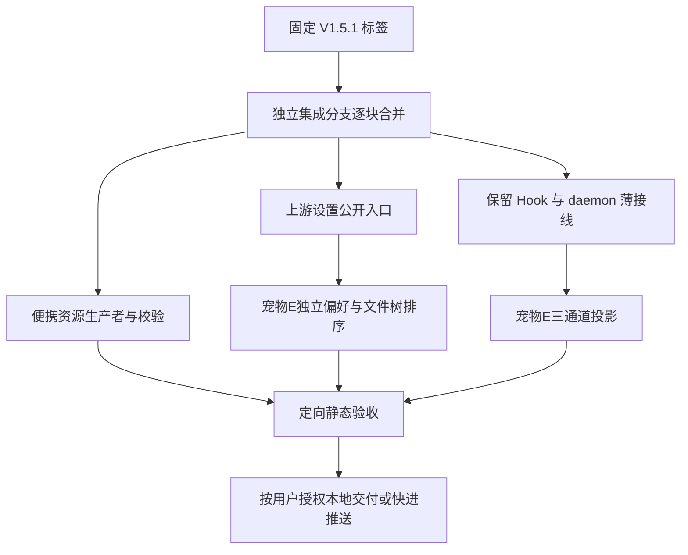
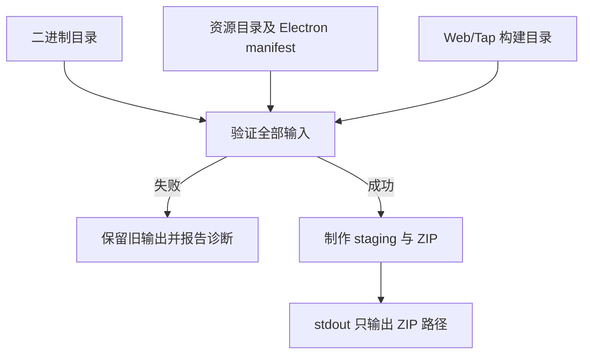

# 技术设计：V1.5.1 正式版集成

## 分诊与证据

这是跨层上游集成，不是已知行为故障的局部修补。
风险在上游契约移动与 fork 消费入口的交界：文本自动合并成功并不保证新设置类型、资源生产者或脚本输出与 fork 接线一致。
只在有证据的交叉边界补接，不二次设计上游已有功能。

只读调研确认：

- 上游净差异 `50e0f17f` 至 `644cb809` 涉及 458 个路径，18175 行增加、12532 行删除；其中大量变更是 Trellis 记录迁移。
- fork 相对共同祖先有 155 个差异路径，双方共同修改 19 个路径；这是冲突候选清单，不是已发生的合并冲突。
- `V1.5.1` 与 `upstream/master` 不同。用户在看到正式版与开发分支的差别后选择正式版，固定目标而非滚动分支。
- 上游本次没有修改 `features/hooks/`、daemon Hook 状态出口、共享任务清单或 `prepare-bundle-binaries.mjs`；Pi v12 和宠物旁路可保持原主体。

## 技术决策

- KTD1. **固定正式版并隔离现场。** 从 fork 当前起点分出 `integrate/v1.5.1-desktop-pet-e`，只合入 `644cb809`。
  用户已选择正式标签而非 master；标签后的历史页面信息栏隐藏修复不偷偷回移。
- KTD2. **逐块合并，迁移消费点。** 不整文件取 ours/theirs。共有文件只保留薄接线，现存外挂仍由原独立文件承载。
- KTD3. **保留设置公开兼容入口。** 接纳上游 `appearanceSettings.ts` 与 `settingsSections.ts` 抽离，宠物E加入新 `LastSettingsTab` 和 `LAST_SETTINGS_TABS`；原 `settingsStore.ts` 不保留同名旧定义。
  `desktopPetEPreferences.ts` 继续维护自己的折叠、迁移和互斥，`fileTreeSortPreference.ts` 的串行写入保持原样。
- KTD4. **便携资源服从生产者，校验不可降级。** 二进制来自 SourceDir，资源来自 ResourcesDir，Web/Tap 来自 WebDistDir；宠物路径从已解析资源根派生，不从 Cargo 产物目录猜测。
  全部验证先于已有 staging/ZIP 清理；不跳过 manifest、PE 架构、文件摘要和许可检查。
- KTD5. **明确打包输出契约。** stdout 只返回归一化后的 ZIP 路径；宠物校验成功/失败的诊断保持可见并与路径输出分离，不静默吞日志。
  原 verifier 的纯函数可复用，避免复制校验业务或为测试关闭保护。
- KTD6. **模板不因应用升版而变。** 默认维持 Pi 12/12 与 2 秒超时；确需改内容时按 R4 同步升版，保留正式 UI、通知和 pendingAction 三条轨道。
  新终端信息栏按上游普通状态投影，不将私有等待注入 Replay 或普通 Hook 类型；它不等同于宠物E待答计数，本轮不扩大其统计口径。
- KTD7. **退休改动限定于源码与自有历史。** 接纳 ccusage 专属删除、迁移 42 和 mini-trellis 共有记录迁移，保留 fork 独有记录；不运行实际迁移或旧/新任务驱动脚本。
- KTD8. **验证与发布分开。** 本轮以源码/契约静态核查为边界；用户确认后才能合并、提交或推送。推送只允许普通快进，远端有新增分叉则停下告知，不强行覆盖。

## 高层接线

## 交叉发现清单

| 触点 | 处理与验收 |
|---|---|
| `.github/workflows/release.yml`、`.gitignore` | 接纳便携包回归及 helper 缓存排除，保留 fork 的宠物构建、发布入口和资源排除规则 |
| `CHANGELOG.md`、`docs/功能清单.md`、`package.json` | 上游 V1.5.1 记录及依赖退役与 fork 条目、测试入口并存 |
| `scripts/package-portable.ps1` | 生产者路径与宠物校验合并；验证先于输出清理，stdout 契约不破坏 |
| `src-tauri/src/commands/mod.rs`、`src-tauri/src/lib.rs` | ccusage 退役和 app_memory 注册与宠物E/问答命令并存；不丢 IPC 或后台 broker 注册 |
| `src/app/App.tsx` | 接纳 ccusage 退役与新会话激活入口，保留宠物 coordinator 和私有事件提前返回 |
| `src/features/files/api/FileExplorerSidebar.tsx` | 接纳固定头部布局，保留排序入口及纯树排序 |
| `src/features/settings/api/SettingsModal.tsx`、`src/features/settings/components/SettingsIcons.tsx` | 新信息栏页、状态栏设计器与宠物E标签/图标并存 |
| `src/features/sync/lib/syncSettings.ts` | 删除 ccusage 字段，添加上游新偏好，保留宠物E折叠和文件树排序备份分类 |
| `src/features/terminal/components/BackgroundTasksPanel.tsx` | 接纳新图标，保留明确 none 的本地化空闲，不回退为运行中 |
| `src/features/terminal/hooks/useTerminalTabsController.tsx` | 接纳历史消息跳转与新激活 props；保留共享清单和独立待答关注覆盖，检查合并后长度 |
| `src/features/terminal/store/terminalRuntime.ts` | 接纳子代理有界缓冲抽离，保留 Pi 身份绑定前复位守卫；私有等待不进入普通状态/Replay |
| `src/shared/i18n/messages/terminal.{zh-CN,en-US}.ts` | 上游新增词条与空闲/宠物入口文案并存，中英文完整 |
| `src/shared/preferences/settingsStore.ts` | 接纳设置抽离、信息栏和侧栏偏好；保留宠物独立迁移与公开兼容导出 |

### 自动合并以外必须核对

- `src/shared/preferences/appearanceSettings.ts` 是上游新增文件，只靠交叉路径列表会漏掉宠物E标签的迁移。
- `scripts/package-portable.test.mjs` 新夹具只有 Web/Tap、ConPTY、SSH 资源，仅复制 PowerShell 入口；保留宠物校验后需要真实可验证的 Electron 夹具及 verifier 入口。复用 `scripts/petEPackage.test.mjs` 的完整 fixture 模式，不下载或执行真实 Electron。
- `scripts/settingsIcons.test.mjs` 仍断言固定 20 项，新信息栏页新增图标，必须对齐实际导航集合并保留宠物E存在性验证。
- `scripts/petEPackage.test.mjs` 仍断言旧的完整 `apps/web/dist/tap/index.html` 字面量，应改验新的 WebDistDir/相对入口接线，不删除保护。
- `src/features/terminal/hooks/useTerminalStatusBarData.ts` 新增消费者复用原宠物归并器；原解析器对 Pi 明确 none 的支持应继续生效。私有待答/只读等待仍只由原外挂处理。
- `src-tauri/src/features/system/app_memory.rs` 用父链、可执行路径、子命令及 daemon 登记判定孤儿；现有宠物以 `electron.exe` 启动且在本应用 ChildJob 下，无证据需要改规则。保留判定边界，不按宠物参数或名称扩大清理范围。
- `src-tauri/helpers/{Cargo.toml,Cargo.lock,build.rs}` 接纳 1.5.1、压缩依赖及 MSVC 最终链接修复，继续复用包含 fork 模块的主库。
- `src-tauri/src/app/migrations.rs` 只追加上游迁移 42，不改历史迁移；`apps/server/migrations/0008_browser_event_retention.sql` 和 Web 认证源码保持上游边界，不访问用户认证数据。
- `.trellis/` 只接纳上游共有历史迁移；本轮三份方案和 fork 历史不作为上游任务引擎清理目标。

## 风险与限制

- 本轮还未合并，实际冲突位置由实施结果确认；共同改动的 19 个路径不能描述为 19 个冲突。
- 上游正式版注释中信息栏默认关闭与实际默认开启存在措辞差异，按实际默认值和已发布行为接纳，不据此改产品行为。
- 正式标签未含 master 的历史页面信息栏隐藏修复；保持范围选择的同时明确交付这一已知差异。
- 尚未执行类型/架构检查、编译或行为测试；源码接线可达不等于发布产物可用。独立子代理、GitNexus 和多模型复审未执行，不能声称独立审查通过。
- broker `/open` 服务端按 Tab 替换的乱序风险仍在，见 `pet-e/docs/pi-terminal-prompt.md`。

## 资料定位

依据来自本地 Git 对固定上游标签、共同祖先及 fork 起点的差异和新文件，以及现有 `pet-e/docs/pi-terminal-prompt.md`、`.trellis/spec/backend/cli-hook-contracts.md`、`.trellis/spec/guides/fix-triage-guide.md`。
未启动 Pi 或应用，不依赖外部通用建议代替本次版本源码。
